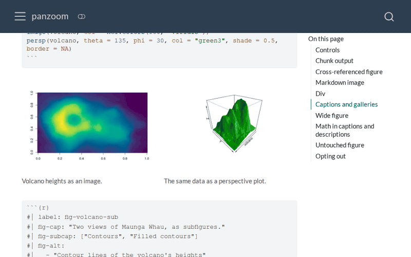

# panzoom

**Live demo:** <https://sekoclancy.github.io/panzoom/>

A [Quarto](https://quarto.org) extension that opens figures in a
full-screen viewer, built on
[Panzoom](https://github.com/timmywil/panzoom). It is inspired by Quarto's
[lightbox](https://quarto.org/docs/output-formats/html-lightbox-figures.html),
and `#| panzoom:` options override `#| lightbox:` ones.

## Installation

You can install this extension using the Quarto CLI (Quarto >=1.9):

```bash
quarto add sekoclancy/panzoom
```

This will install the extension under the `_extensions` subdirectory.
If you're using version control, you will want to check in this directory.

### From source

To build the demo site and examples from a clone, with
[uv](https://docs.astral.sh/uv/):

```bash
git clone https://github.com/sekoclancy/panzoom && cd panzoom
uv venv .venv                               # creates the venv with Python 3.14
uv pip install -r tests/requirements.txt    # matplotlib, ipykernel, etc.
quarto render                               # build into docs/
```

The venv is only for the Python (Jupyter) examples; the rest need R, with the `ragg` package. See [Development](#development) for previewing and publishing.

## Demo



## Viewer controls

| Action | Mouse or touch | Keyboard |
|---|---|---|
| Zoom | scroll or pinch, toward the cursor | + and - |
| Pan | drag, or Shift+scroll | arrow keys |
| Go back to the opening view | double-click | 0 |
| Change image in a gallery | the previous and next buttons, or swipe | left and right arrow |
| Close | the × button, or click the background | Esc |

Zoom goes up to `max-zoom`. While an image is larger than the screen
(zoomed in, or a wide figure), the arrow keys and swipes pan it, and only
the buttons change image.

From the keyboard, marked images can be reached with Tab and opened with
Enter or Space; Tab moves between the viewer's buttons, and closing returns
focus to the image.

## Features

- Zoom toward the cursor with scroll or pinch, in steps up to `max-zoom`
  (the lightbox only toggles between fit and real size, and not at all on
  screens 768 px wide or less)
- Pan by dragging, using the arrow keys, or Shift+scroll
- [Captions](#captions) and [descriptions](#descriptions) with math,
  citations, and cross-references (the lightbox shows raw TeX and `[@key]`)
- [Galleries](#galleries) from groups and subfigures, and figure
  [layouts](#layouts)
- [Wide and tall figures](#wide-and-tall-figures) open readable, at the
  spot you clicked
- Applies to every figure (`panzoom: true`) or only the images you mark,
  in code cells or markdown
- Keyboard access; [restyle it](#styling) with options or CSS
- [Math](#math) in any `html-math-method`, offline too; works in
  [self-contained documents](#self-contained-documents) and
  [without JavaScript](#without-javascript)

Not offered (lightbox has these):

- Caption position: the caption is always below the image (no
  `desc-position`)
- Opening effects: the viewer opens and closes at once (no `effect`)

## Usage

panzoom is a filter: turn it on for one document in its YAML header, or
for every page of a Quarto project (website, book) in `_quarto.yml`:

```yaml
filters:
  - panzoom
```

### Global Panzoom

With `panzoom: true`, every figure opens in the viewer, as does any image
alone in its own paragraph. Images inside a line of text are left out.
These are the same images Quarto's `lightbox: true` takes.

```yaml
filters:
  - panzoom
panzoom: true
```

`panzoom: auto` is the same as `true` (to match `lightbox:` options), and
`panzoom: false` turns panzoom off for the document, even for marked
images. Without the setting, only the images you mark open in the viewer.

### Marking images

**Code cells** (R with knitr, or Python and others with Jupyter): use the
`panzoom` cell option.

````markdown
```{r}
#| panzoom: true

plot(pressure)
```
````

**Markdown images:** use the class directly.

```markdown
{.panzoom}
```

This also works for an image inside a line of text, which `panzoom: true`
skips:

```markdown
Some text with an inline image {.panzoom width=60px} in the middle.
```

**Any block:** wrap it in a div.

```markdown
::: {.panzoom}


:::
```

To leave out a code cell's plots, use `#| panzoom: false`; to leave out a
markdown image, give it `.nopanzoom`. An image inside a link keeps its
link.

### Options

Options go under `panzoom:` in place of `true`:

```yaml
panzoom:
  match: auto     # every figure, same as panzoom: true; leave out for only marked images
  max-zoom: 4     # number: screen pixels per image pixel, at most (default 4)
  hint: true      # boolean: show the controls hint at the bottom (default true)
  caption: true   # boolean: show the figure caption in the viewer (default true)
  loop: false     # boolean: in a gallery, wrap from the last image to the first (default false)
  fit: auto       # auto, contain, height, or width (default auto, see Wide and tall figures)
  css-class: my-viewer  # an extra class on the viewer, for styling it (default none; see Styling)
  backdrop: black             # colours (see Styling): the layer over the page,
  caption-background: black   # the caption band,
  caption-color: white        # caption, description, and hint text,
  link-color: lightblue       # and links in captions (defaults follow the theme)
```

A code cell can set `max-zoom`, `hint`, `caption`, and `fit` for its own
plots, as well as `group` and `description`, by giving `#| panzoom:`
options instead of `true`:

````markdown
```{r}
#| panzoom:
#|   max-zoom: 8
#|   hint: false

plot(pressure)
```
````

A misspelled option or a wrong value stops the render to match Quarto `lightbox` behavior.

```
ERROR: Validation of panzoom options failed.
ERROR: In file index.qmd
property name max-zom is invalid
ℹ The error happened in location panzoom:max-zom.
ℹ Did you mean max-zoom?
```

### Captions

The viewer shows the figure's caption, with its number, math, citations,
and cross-references, under the image; turn it off with `caption: false`.

### Descriptions

A description, written in Markdown, is shown under the caption:

```markdown
{.panzoom description="The best beaches. **Credit:** [Unsplash](https://unsplash.com)"}
```

or for all of a cell's plots:

````markdown
```{r}
#| panzoom:
#|   description: "Pressure rises with temperature, $p \propto e^{-1/T}$."

plot(pressure)
```
````

### Galleries

Subfigures of one figure form a gallery on their own. Other images join
one with a group name, on markdown images:

```markdown
{.panzoom group="beach"}
{.panzoom group="beach"}
```

or for all of a cell's plots:

````markdown
```{r}
#| panzoom:
#|   group: pressure

plot(pressure)
plot(pressure, log = "y")
```
````

### Layouts

Figures in layouts (`layout-ncol`, `layout-nrow`, layout divs) work too:
each image in a layout opens on its own, and subfigures form a gallery.

### Wide and tall figures

| Figure | Opens | Same as |
|---|---|---|
| Most images | whole, never larger than real size | `fit: contain` |
| Very wide (e.g. a row of many panels) | at screen height, at the spot you clicked | `fit: height` |
| Very tall | at screen width, from the top | `fit: width` |

The [examples' page H](https://sekoclancy.github.io/panzoom/tests/pages/h-wide.html)
has the exact rules and an example of each shape. Set `fit:` to choose
for one figure:

````markdown
```{r}
#| panzoom:
#|   fit: contain
#| fig-width: 25
#| fig-height: 2

par(mfrow = c(1, 12), mar = c(3, 3, 2, 1))
for (i in 1:12) plot(cumsum(rnorm(200)), type = "l", main = paste("Panel", i))
```
````

or for a whole document, where a cell's own `fit:` still wins:

```yaml
panzoom:
  match: auto
  fit: contain    # every figure opens whole
```

### Math

Math in captions and descriptions shows as it does on the page, with any
`html-math-method`. MathJax and KaTeX need a connection; for a file whose
math works offline, render it with MathJax and:

```yaml
embed-resources: true
self-contained-math: true
```

### Self-contained documents

panzoom works in a self-contained document, with no internet access:

```yaml
filters:
  - panzoom
embed-resources: true
```

### Without JavaScript

A click on a marked image opens the image file itself, as with Quarto's
lightbox. (In a self-contained file that link leads nowhere, for both.)

### Styling

Set the viewer's colours with the options, or with the CSS variables they
stand for in your own CSS (a `css:` file, or the theme's `.scss`):

| Option | CSS variable | Element | Default |
|---|---|---|---|
| `backdrop` | `--panzoom-backdrop` | The layer over the page | `rgba(0, 0, 0, 0.7)` |
| `caption-background` | `--panzoom-bg` | The caption band | The page's background |
| `caption-color` | `--panzoom-fg` | Caption, description, and hint | The page's text colour |
| `link-color` | `--panzoom-link` | Links in captions | The page's link colour |

```yaml
panzoom:
  backdrop: rgba(0, 0, 0, 0.9)   # any CSS colour: rgba(),
  caption-background: "#222"    # hex (quoted, for YAML),
  caption-color: white           # or a name
```

The examples' [Styling pages](https://sekoclancy.github.io/panzoom/reference.html#styling)
show both ways. In CSS, for every viewer on the site:

```css
.panzoom-overlay { --panzoom-backdrop: black; }
```

For some documents only, give the viewer a class with `css-class` and
write the rule for that class:

```yaml
panzoom:
  css-class: dark-viewer
```

```css
.dark-viewer { --panzoom-backdrop: black; --panzoom-bg: black; --panzoom-fg: white; }
```

To set `css-class` (or any option) for a whole site, put it under
`format: html:` in `_quarto.yml`: a top-level `panzoom:` there is replaced,
not merged, by a page's own `panzoom:` options.

For anything the variables don't cover, the viewer's parts have their own
classes: `.panzoom-footer` (the caption band), `.panzoom-caption`,
`.panzoom-description`, `.panzoom-hint`, `.panzoom-close`, `.panzoom-prev`,
`.panzoom-next`, and `.panzoom-counter`. Start the selector with the
viewer's class, as in `.dark-viewer .panzoom-caption`, so it wins over
panzoom's own rules.

## Development

Set up a clone as in [From source](#from-source), then:

```bash
quarto preview             # build and open in a browser, re-rendering on save
quarto publish gh-pages --no-prompt --no-browser   # build and publish to GitHub Pages
```

Before the first publish, create an empty `gh-pages` branch once
(`--no-prompt` can't create it):

```bash
git branch gh-pages $(git commit-tree $(git hash-object -t tree /dev/null) -m "Initializing gh-pages branch")
git push origin gh-pages
```

See [tests/README.md](tests/README.md) for the tests and their setup.
