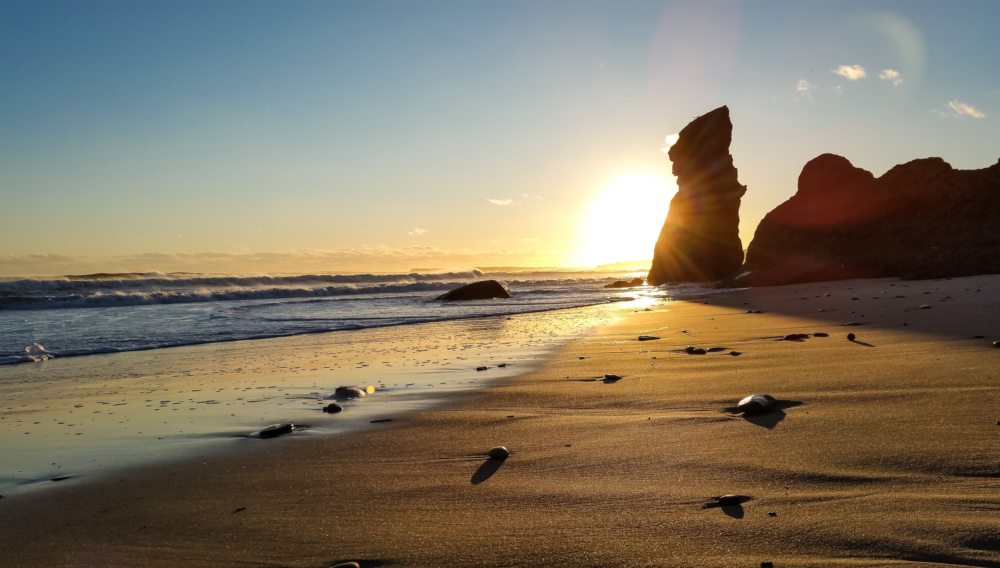
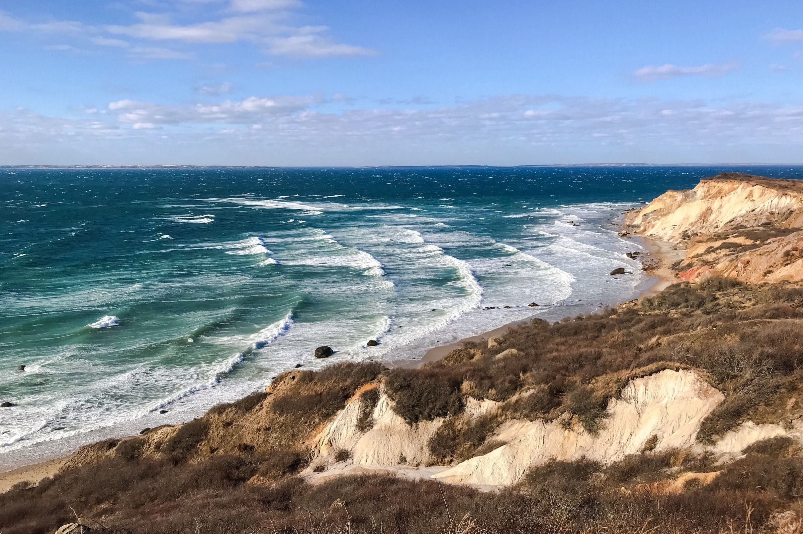
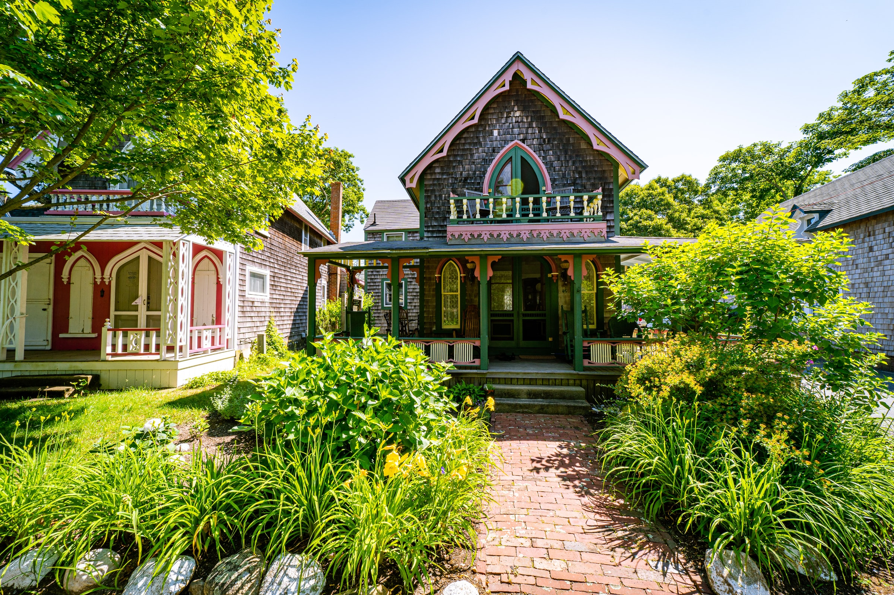
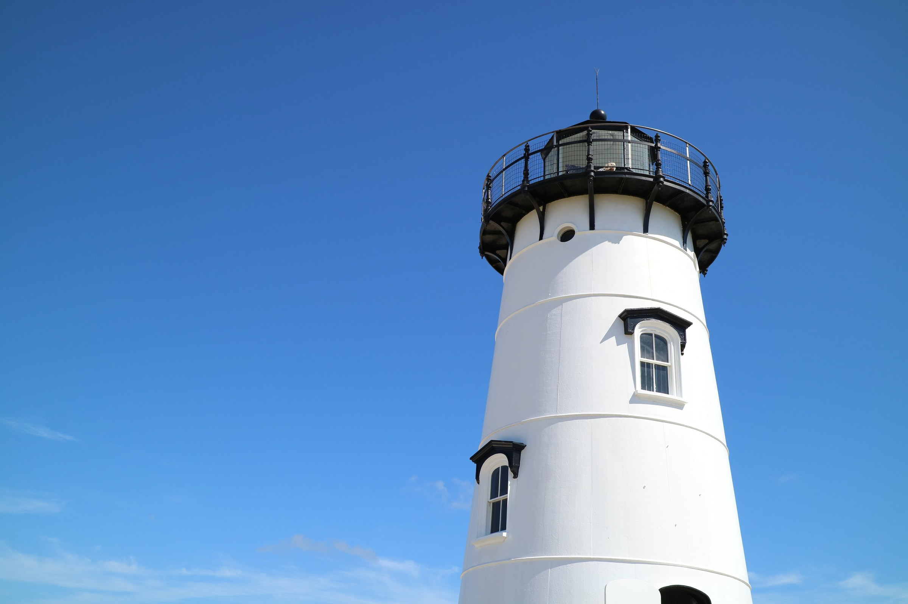
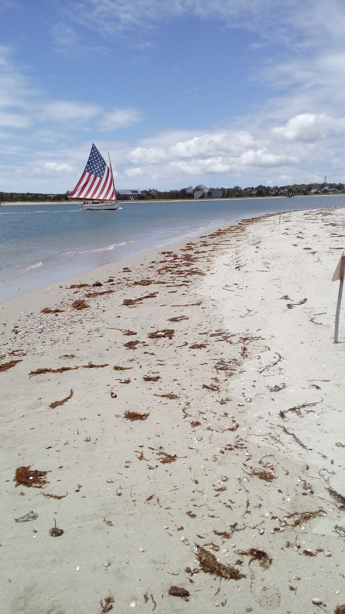

Only images marked with the `.panzoom` class or the `#| panzoom: true` cell
option open in panzoom. lightbox is not set in the YAML header, so clicking any
other image does nothing, except in [cells that ask for
lightbox](#sec-grouped-cells) with options of their own. The same cases open in
lightbox alone on the [`lightbox` comparison](a-lightbox-r.html), and with
lightbox on for the whole page on [selected images with
`lightbox`](b-mixed-r.html). The YAML header turns on panzoom and turns off the
hint line:

```yaml
---
filters:
  - panzoom
panzoom:
  hint: false
---
```

## Single image {expect-open="panzoom" expect-desc-position="left"}

A markdown image with `.panzoom`, a description, and `desc-position="left"`. It
opens in panzoom, with the caption and description in a panel on the left of the
image.

```markdown {.show-source}
{.panzoom description="Chilmark has _some_ of the best beaches. **credit:** [Chilmark Beach](https://unsplash.com/photos/VBDJGOMCwps)" desc-position="left" fig-alt="Sunset over a sandy beach, with a tall rock stack against the sun"}
```

## Gallery in a layout {expect-open="nothing panzoom nothing"}

Three images in a layout, joined by `group="elsewhere"`. Only the middle one
(Oak Bluffs) has `.panzoom`, so it opens in panzoom on its own. lightbox is not
set in the YAML header, so clicking the other two does nothing.

```markdown {.show-source}
::: {layout="[[1, 1], [1]]"}
{group="elsewhere" description="The waves break off Aquinnah." fig-alt="Waves breaking below grassy clay cliffs at Aquinnah"}

{.panzoom group="elsewhere" description="Gingerbread cottages." fig-alt="A shingled gingerbread cottage with pink and green trim, behind a garden path"}

{group="elsewhere" description="Edgartown Lighthouse." fig-alt="A white lighthouse against a blue sky"}
:::
```

## Math {expect-open="panzoom"}

A markdown image with `.panzoom` and math in its caption and description. It
opens in panzoom with both typeset.

```markdown {.show-source}
{.panzoom description="Description with math $\\int_0^1 x^2\\,dx = 1/3$" fig-alt="A sailboat with a flag-striped sail off a sandy beach"}
```

## Markdown subfigures {#sec-markdown-subfigures expect-open="panzoom"}

A figure with two markdown subfigures, both with `.panzoom`. Either one opens in
panzoom, in a two-image gallery. The figure's caption links to the [heat map of
Maunga Whau](#sec-plain-r-figure).

```markdown {.show-source}
::: {#fig-md-sub layout-ncol=2}
{#fig-md-a .panzoom fig-alt="Waves breaking below grassy clay cliffs at Aquinnah"}

{#fig-md-b .panzoom fig-alt="A white lighthouse against a blue sky"}

Aquinnah and Edgartown Lighthouse, on Martha's Vineyard. For heights of Maunga Whau instead, see @fig-plain.
:::
```

## Image in a link {#sec-image-in-a-link expect-open="navigation"}

An image with `.panzoom` inside a link. panzoom leaves linked images alone, so
clicking the image follows the link.

```markdown {.show-source}
[{.panzoom width=30% fig-alt="A sailboat with a flag-striped sail off a sandy beach, with an unrelated link to open the Quarto website"}](https://quarto.org)
```

## Margin image {expect-open="panzoom"}

A markdown image with `.panzoom` in the margin. It opens in panzoom, as any
other marked image does.

```markdown {.show-source}
{.panzoom .column-margin fig-alt="A shingled gingerbread cottage with pink and green trim, behind a garden path"}
```

## Inline image {expect-open="panzoom" expect-caption="none"}

An image with `.panzoom` inside a sentence. It opens in panzoom, with no
caption, since an inline image isn't a figure and has none.

```markdown {.show-source}
Some text with an inline image {.panzoom width=60px} in the middle.
```

## R subfigures {expect-open="panzoom"}

One R cell with `panzoom: true` and two plots, made subfigures by `fig-subcap`.
Either one opens in panzoom, in a two-image gallery.

```{r}
#| panzoom: true
#| label: fig-r-sub
#| layout-ncol: 2
#| fig-alt:
#|   - "Scatter plot of vapor pressure rising steeply with temperature"
#|   - "Scatter plot of stopping distance against speed for 50 cars"
#| fig-cap: >-
#|   Vapor pressure of mercury, and stopping distances of cars.
#| fig-subcap: ["Pressure", "Cars"]

plot(pressure)
plot(cars)
```

## Grouped cells {#sec-grouped-cells expect-open="panzoom glightbox"}

Two R cells in the lightbox group `r-graph`. The first also has
`#| panzoom: true`, so it opens in panzoom on its own, without the lightbox
description. The second has only lightbox options, which turn lightbox on for
that cell, so it opens in lightbox, alone in its group.

```{r}
#| panzoom: true
#| lightbox:
#|   group: r-graph
#|   description: Ten random points.
#| fig-alt: "Scatter plot of ten random points"
#| fig-cap: >-
#|   Ten random points against their index.

plot(1:10, rnorm(10))
```

```{r}
#| lightbox:
#|   group: r-graph
#|   description: Stopping distance against speed.
#| fig-alt: "Scatter plot of stopping distance against speed for 50 cars"
#| fig-cap: >-
#|   Stopping distance against speed for 50 cars.

plot(cars)
```

## Two plots in one cell {expect-open="panzoom"}

One R cell with `#| panzoom: true`, two plots, and the lightbox options
`group: cars` and a description for each plot. panzoom drops the lightbox
options, so each plot opens in panzoom on its own, without a description.

```{r}
#| panzoom: true
#| lightbox:
#|   group: cars
#|   description:
#|     - The mtcars data, each variable against every other.
#|     - Stopping distance against speed.
#| fig-alt:
#|   - >-
#|     Scatterplot matrix of the mtcars data, each variable plotted against
#|     every other
#|   - "Scatter plot of stopping distance against speed for 50 cars"
#| fig-cap:
#|   - "The mtcars data, each variable plotted against every other."
#|   - "Stopping distance against speed for 50 cars."

plot(mtcars)
plot(cars)
```

## Opt out a cell {expect-open="nothing"}

An R cell with `lightbox: false` and no `#| panzoom: true`. Neither viewer takes
it, so clicking it does nothing.

```{r}
#| lightbox: false
#| fig-alt: >-
#|   Scatterplot matrix of the mtcars data, each variable plotted against every
#|   other
#| fig-cap: "The mtcars data, each variable plotted against every other."

plot(mtcars)
```

## Plain R figure {#sec-plain-r-figure expect-open="nothing"}

A cross-referenced R figure with no options. It isn't marked, so clicking it
does nothing.

```{r}
#| label: fig-plain
#| fig-alt: >-
#|   Heat map of the Maunga Whau volcano's heights, in yellow, orange, and red
#| fig-cap: >-
#|   Heights of Maunga Whau (Mount Eden), from pale yellow (low) to dark red
#|   (high).

image(volcano)
```

## Cell with a link {expect-open="navigation"}

An R cell with `panzoom: true` and `fig-link`, which puts its plot inside a
link. As for the [image in a link](#sec-image-in-a-link), clicking the plot
follows the link.

```{r}
#| panzoom: true
#| fig-link: "https://quarto.org"
#| fig-alt: "Scatter plot of vapor pressure rising steeply with temperature"
#| fig-cap: "Vapor pressure of mercury against temperature."

plot(pressure)
```

## Credits {.unnumbered}

The photos are from Unsplash, under the [Unsplash
license](https://unsplash.com/license):

- [Chilmark Beach](https://unsplash.com/photos/VBDJGOMCwps)
- [Aquinnah](https://unsplash.com/photos/2iQnDPLIXwU)
- [Gingerbread House](https://unsplash.com/photos/HQEtvlNzUyA)
- [Edgartown Light](https://unsplash.com/photos/f59MyOfLpi8)
- [Edgartown Sailboat](https://unsplash.com/photos/IiLiz7XpQpI)
