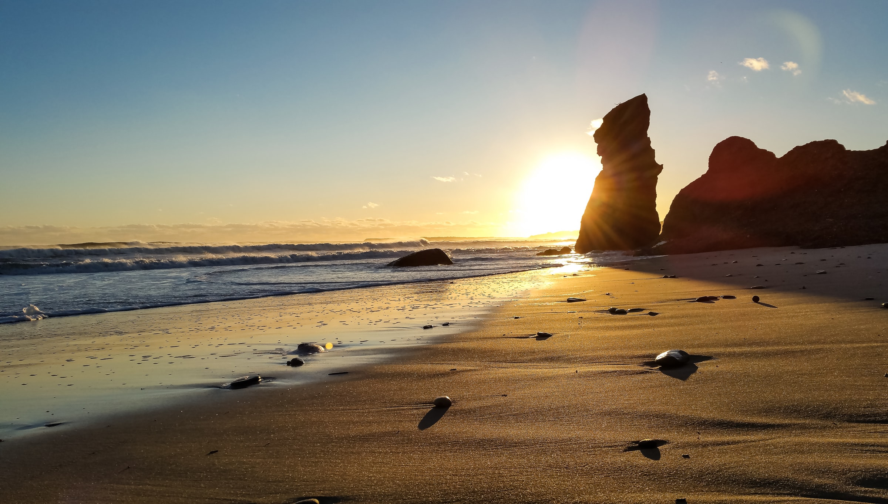
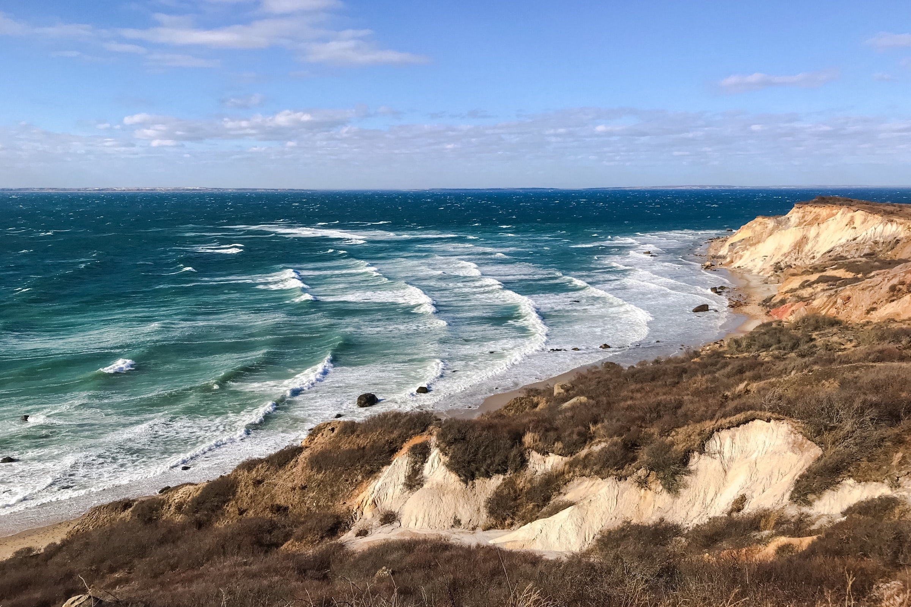
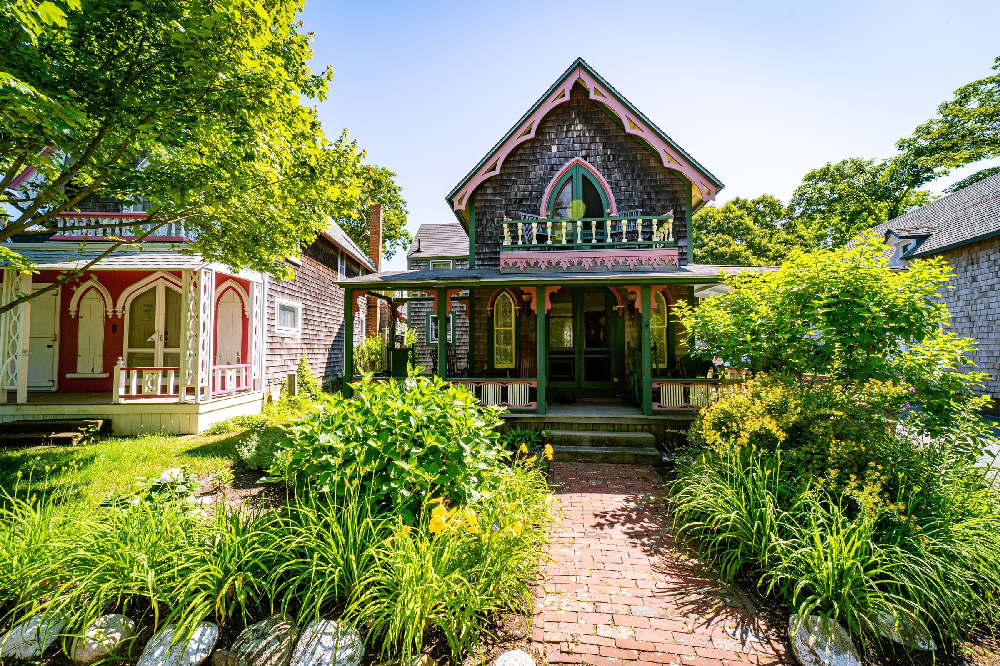
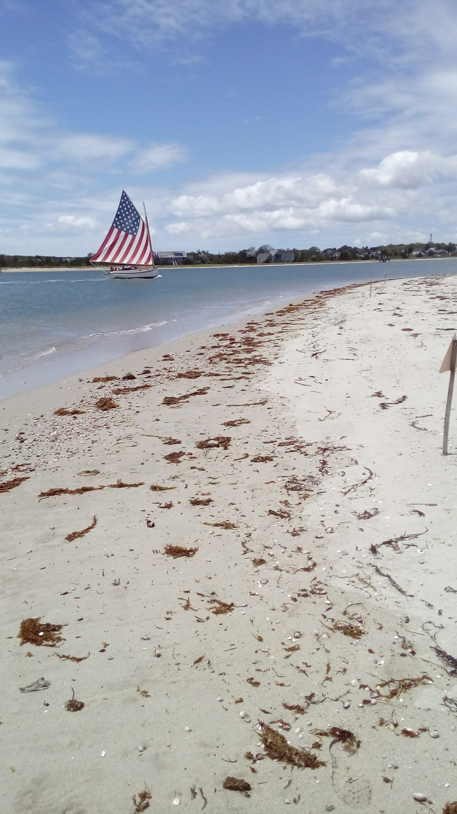

## Setup

panzoom works in revealjs slides as on any HTML page. The YAML header turns it
on for every image:

```yaml
---
format: revealjs
filters:
  - panzoom
panzoom: true
---
```

While the viewer is open, the slide keys go to the viewer. Escape closes the
viewer, not the slide overview.

[Back to the example page](u-revealjs-r.html){target="_top"}

## Single image {expect-open="panzoom"}

{fig-alt="Sunset over a sandy beach, with a tall rock stack against the sun" height="420"}

## Gallery {expect-open="panzoom"}

::: {layout-ncol="3"}
{group="slides" fig-alt="Waves breaking below grassy clay cliffs at Aquinnah"}

{group="slides" fig-alt="A white lighthouse against a blue sky"}

{group="slides" fig-alt="A shingled gingerbread cottage with pink and green trim, behind a garden path"}
:::

## Plot {expect-open="panzoom"}

```{r}
#| fig-height: 4
#| fig-alt: >-
#|   Heat map of the Maunga Whau volcano's heights, in yellow, orange, and red
#| fig-cap: "Heights of Maunga Whau (Mount Eden)."

image(z = volcano)
```

## Wide figure {expect-open="panzoom"}

With `fit: height`, it opens at the screen height, at the clicked spot.

```{r}
#| panzoom:
#|   fit: height
#| fig-width: 24
#| fig-height: 2
#| fig-alt: >-
#|   A row of 12 small line plots of random walks, each in its own color
#| fig-cap: "A 24 × 2 inch strip of 12 random walks."

set.seed(1)
par(mfrow = c(1, 12), mar = c(2, 2, 1, 0.5))
for (i in 1:12) {
  plot(cumsum(rnorm(100)), type = "l", col = hcl.colors(12)[i], main = i)
}
```

## Fragment {expect-open="panzoom"}

The image shows on the next key press, and opens once it shows.

::: {.fragment}
{fig-alt="A sailboat with a flag-striped sail off a sandy beach" height="360"}
:::

## Credits

The photos are from Unsplash, under the [Unsplash
license](https://unsplash.com/license):

- [Chilmark Beach](https://unsplash.com/photos/VBDJGOMCwps)
- [Aquinnah](https://unsplash.com/photos/2iQnDPLIXwU)
- [Gingerbread House](https://unsplash.com/photos/HQEtvlNzUyA)
- [Edgartown Light](https://unsplash.com/photos/f59MyOfLpi8)
- [Edgartown Sailboat](https://unsplash.com/photos/IiLiz7XpQpI)
