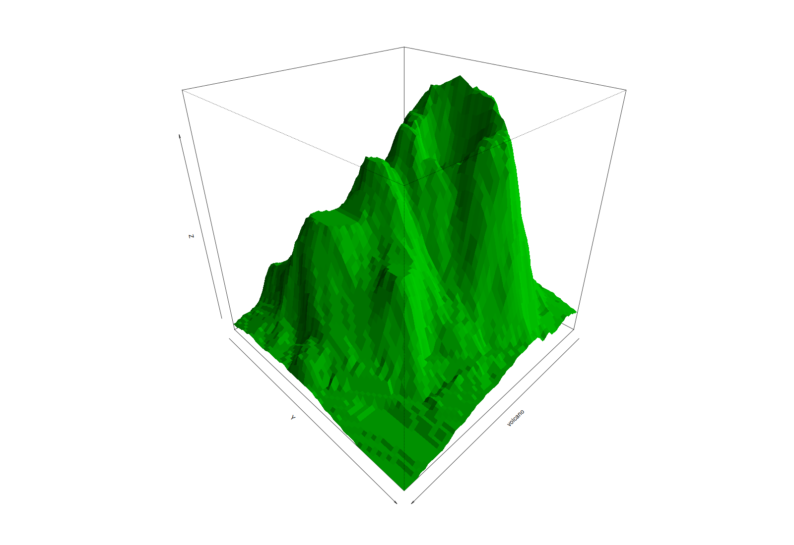

This is a [Quarto](https://quarto.org) extension that opens figures in a
full-screen viewer, built on [Panzoom](https://github.com/timmywil/panzoom):
scroll to zoom toward the cursor, drag to pan, double-click or `0` to reset,
Esc to close. It attempts to match, and extend, the feature set of Quarto's
built-in
[lightbox](https://quarto.org/docs/output-formats/html-lightbox-figures.html).
Source and documentation: <https://github.com/sekoclancy/panzoom>.

```bash
quarto add sekoclancy/panzoom
```

## Chunk output

Mark a code cell with `#| panzoom: true`. Click the figure to open it, scroll
to zoom toward the cursor, drag to pan, double-click to reset, Esc to close.

```{r}
#| panzoom: true
#| fig-width: 12
#| fig-height: 4
image(volcano, col = hcl.colors(100, "Viridis"), asp = 1 / 3)
```

## Cross-referenced figure

Labeled figures work too (@fig-volcano). Options under `#| panzoom:` override
the document's settings for one cell: this figure zooms to 10 instead of the
page's 6, and hides the hint.

```{r}
#| label: fig-volcano
#| fig-cap: "Maunga Whau volcano."
#| panzoom:
#|   max-zoom: 10
#|   hint: false
filled.contour(volcano, color.palette = terrain.colors)
```

## Markdown image

```{r}
#| include: false
png("volcano.png", width = 1600, height = 1100)
persp(volcano, theta = 135, phi = 30, col = "green3", shade = 0.5, border = NA)
invisible(dev.off())
```

{.panzoom}

## Captions and galleries

The viewer shows the figure's caption. Plots with the same `group` form a
gallery: use the ‹ › buttons, `←`/`→` or a swipe to step through them.
Subfigures of one figure are a gallery automatically.

```{r}
#| panzoom:
#|   group: volcano-views
#| fig-cap:
#|   - "Volcano heights as an image."
#|   - "The same data as a perspective plot."
#| layout-ncol: 2
image(volcano, col = hcl.colors(100, "Viridis"))
persp(volcano, theta = 135, phi = 30, col = "green3", shade = 0.5, border = NA)
```

```{r}
#| label: fig-volcano-sub
#| fig-cap: "Two views of Maunga Whau, as subfigures."
#| fig-subcap: ["Contours", "Filled contours"]
#| layout-ncol: 2
#| panzoom: true
contour(volcano)
image(volcano)
```

## Untouched figure

Without the option, Quarto's own lightbox still handles the figure.

```{r}
contour(volcano)
```

## Opting out

Inside a `.panzoom` div, `.nopanzoom` leaves one image alone. For a whole
cell, use `#| panzoom: false`.

::: {.panzoom}
{.nopanzoom width=40%}
:::

## Test pages

The same 12 lightbox situations (galleries, subfigures, captions with math,
images in links, margin images, ...) rendered four ways:

- [A: Quarto lightbox reference](tests/pages/a-lightbox.html): Quarto's
  built-in lightbox alone.
- [B: marked images + lightbox](tests/pages/b-panzoom-lightbox.html): the
  usual setup, `lightbox: true` with some images marked for panzoom.
- [C: panzoom `match: auto`](tests/pages/c-panzoom-auto.html): panzoom picks
  the images itself.
- [D: explicit marking](tests/pages/d-panzoom-selective.html): images marked
  with `.panzoom` or `#| classes: panzoom`.

And one page of its own:

- [E: formats and wide figures](tests/pages/e-formats.html): 100 × 5 inch
  collages, and webp, svg and pdf output.
