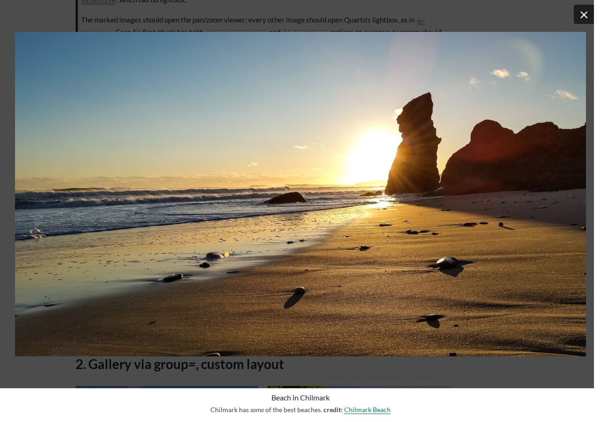

# Tests

Scripts that open the rendered pages in headless Chrome, click each image,
and check the viewer. They save a screenshot of each step for a person to
look at; nothing is compared pixel by pixel.

## Quick start

Set up a clone as in the main README's
[From source](../README.md#from-source), then, from the repo root, once:

```bash
quarto install chrome-headless-shell --no-prompt
(cd tests && npm install)
```

Render, then run the tests from `tests/`:

```bash
quarto render
cd tests && npm test
```

| Command | Checks | Time |
|---|---|---|
| `npm test` | The demo and the example pages (A–N): the viewer per image, zoom, pan, keys, galleries, captions | ~1 min |
| `npm run touch` | The viewer on an emulated phone: tap, pinch, drag, swipe | ~10 s |
| `npm run loading` | Slow and failed images: loading message, late arrivals, error message | ~5 s |
| `npm run nojs` | Every page with JavaScript off: each marked image links to its file | ~10 s |
| `npm run contrast` | Text contrast in light and dark mode, and that the viewer follows the theme | ~7 s |
| `npm run standalone` | Renders and checks the pages outside the site (self-contained, math, `panzoom:` forms) | ~25 s |
| `npm run offline` | The standalone and site pages with no network | ~70 s |
| `npm run bench` | Weight and speed against a saved baseline (`bench:save` saves a new one) | ~1 min |
| `npm run options` | Misspelled and wrong options: each mistake reported, as Quarto words it, and the render stopped; descriptions that look like options come through whole | ~15 s |

Each prints one line per page and exits with an error if a check fails.
The tests read `docs/`, so render again after changing the extension or a
page. To check one page:

```bash
quarto render tests/pages/d-panzoom-selective.qmd                 # from the repo root
node browser.mjs ../docs/tests/pages/d-panzoom-selective.html     # from tests/
```

## Setup

| Need | For | Install |
|---|---|---|
| [Quarto](https://quarto.org) 1.9 or later | Rendering | |
| R with the `ragg` package | The R pages (`ragg` for page E's webp figures) | |
| Python 3.14 venv | Pages J–L | [From source](../README.md#from-source) |
| [Node.js](https://nodejs.org) 22.12 or later | The scripts | |
| Chrome Headless Shell (about 115 MB) | The browser the tests drive | `quarto install chrome-headless-shell --no-prompt` |
| Puppeteer (`puppeteer-core`, pinned in [package-lock.json](package-lock.json)) | Controlling Chrome | `cd tests && npm install` |

Set `CHROME=/path/to/chrome` to use another Chrome or Chromium. Without
uv, make the venv with
`python3 -m venv .venv && .venv/bin/pip install -r tests/requirements.txt`;
it uses the `python3` on your PATH and ignores `.python-version`.

## Example pages

The example pages are in [pages/](pages/), rendered with the site and
published at <https://sekoclancy.github.io/panzoom/>. Each starts with a
note describing the expected result.

**R (knitr).** A–D render the same 12 cases four ways:

| Page | Description | panzoom | Lightbox |
|---|---|---|---|
| [a-lightbox](pages/a-lightbox.qmd) | **Reference:** Quarto's lightbox on each case | off | `match: auto` |
| [b-panzoom-lightbox](pages/b-panzoom-lightbox.qmd) | **The usual setup:** marked images; the lightbox for the rest | on | `true` |
| [c-panzoom-auto](pages/c-panzoom-auto.qmd) | **Every figure:** A's markup, panzoom with `match: auto` | auto | `match: auto` |
| [d-panzoom-selective](pages/d-panzoom-selective.qmd) | **Marked images only**, no lightbox | on | none |
| [e-formats](pages/e-formats.qmd) | webp, svg, png + pdf, and webp past its 16,383 px limit | on | none |
| [f-options](pages/f-options.qmd) | Opting out, the `hint`, `max-zoom`, and `loop` options | on | none |
| [g-captions](pages/g-captions.qmd) | Citations and cross-references in captions and descriptions | on | none |
| [h-wide](pages/h-wide.qmd) | Wide collages, tall strips, and other shapes, each on its own; `fit` | on | none |
| [i-wide-galleries](pages/i-wide-galleries.qmd) | The same shapes in galleries and layouts, of different lengths | on | none |

**Python (Jupyter).** J and K are the Jupyter counterparts of A and C, on
eight cases:

| Page | Description | panzoom | Lightbox |
|---|---|---|---|
| [j-jupyter-lightbox](pages/j-jupyter-lightbox.qmd) | **Reference:** the lightbox alone (it ignores nested `#\| lightbox:` options with Jupyter) | off | `true` |
| [k-jupyter-auto](pages/k-jupyter-auto.qmd) | **`panzoom: true`:** J's cases; keep the two in step | `true` | `true` |
| [l-jupyter](pages/l-jupyter.qmd) | The R pages' cell options on matplotlib figures, and svg output | on | none |

**Styling**, checked with `expect-overlay` and `expect-band`:

| Page | Description |
|---|---|
| [m-styling-options](pages/m-styling-options.qmd) | The color options, no CSS |
| [n-css-class](pages/n-css-class.qmd) | `css-class` with a stylesheet, [n-css-class.css](pages/n-css-class.css): the CSS variables and the viewer's parts |

**Outside the site** ([standalone/](standalone/)), rendered by
`npm run standalone` as plain documents:

| Page | Description |
|---|---|
| [self-contained](standalone/self-contained.qmd) | A single HTML file (`embed-resources: true`) opened from disk; `self-contained-math` also embeds MathJax |
| [self-contained-lightbox](standalone/self-contained-lightbox.qmd) | The same page with Quarto's lightbox (a copy of `_self-contained.qmd`: keep in step) |
| [math-&lt;method&gt;](standalone/_math.qmd) | Math in captions and descriptions with each `html-math-method` |
| [switch-&lt;value&gt;](standalone/switch-true.qmd) | `panzoom: true`, `auto`, and `false` |
| [css-class](standalone/css-class.qmd) | `css-class` and the CSS variables, set by a rule loaded before panzoom's stylesheet |

## Checks

`npm test` ([browser.mjs](browser.mjs)) clicks every image, records the
result (**panzoom**, **glightbox**, **navigation** for a link, or
**nothing**), and runs the checks below. Each shows in the page's summary
line as `... ok`, or in capitals when it fails. Attributes on a case's
heading set its expected results, as in
`## 3. Title {#c3 expect-fit="height"}`.

| Summary | Assumptions |
|---|---|
| `options ok` | The viewer opened matches `expect-open` (one value, or one per image); and `expect-caption="none"`, `expect-hint`, `expect-max-zoom`, `expect-format="svg"`, `expect-class` (on the viewer), `expect-overlay`, and `expect-band` (backdrop and caption band colors) where set |
| `fit ok` | The opening view matches `expect-fit` (`contain`, `height`, `width`), in a 1280 × 900 window and four others (1440 × 780, 1920 × 950, 1920 × 1080, 2560 × 1300); `expect-zoom-out` says whether it can zoom out further |
| `real size ok` | `expect-scale="1"`: a small image opens at its own size |
| `zoom anchor ok`, `fast zoom ok` | Wheel zoom keeps the point under the cursor within 3 px, also with several steps in one frame |
| `containment ok` | Arrow keys and drags stop at a collage's ends; an image shown whole doesn't move |
| `focal point ok` | A strip clicked on the page opens at that spot; `0` returns there; from the keyboard it starts at its end |
| `shift-scroll ok` | Shift+scroll pans the way `shift-scroll` says (`x`, `y`, `none`, `zoomed-x`) |
| `gallery ok` | ←/→, the buttons, and a swipe step through a gallery; zoomed in, → pans instead; PageUp/PageDown don't change image; no wrap without `loop`; focus stays in the viewer at the last image |
| `large galleries ok` | In a gallery of wide or tall figures, → pans and the next button switches |
| `caption clear ok` | An image that fits the screen's height stays clear of the caption band |
| `anchors ok` | `expect-anchors`: each labeled figure keeps its id and its number ("Figure N"), holds an image panzoom marked, and a cross-reference on the page links to it |
| `descriptions ok`, `references ok`, `math ok` | Descriptions show; citations and cross-references are resolved and their links work; math is typeset wherever the page's is |
| `panel scroll ok` | A caption or description marked `expect-scroll` (page G) is reached with Tab and scrolled by the arrows, Page Up/Down, Home, End, and Space, without moving the image or the page |
| `backdrop ok` | Every image is shown on an opaque backdrop |
| `isolation ok` | Keys pressed in the viewer don't reach the page behind it (Ctrl+key and function keys do), and a widget at z-index 10000 stays underneath |
| `keyboard ok` | Tab reaches the image, Enter or Space opens it, zoomed in the arrows pan both ways, Tab stays in the viewer, Esc closes, focus returns |
| `page still ok` | Opening the viewer doesn't shift the page behind it where scrollbars take up room |

Console errors and outside requests are counted but don't fail the run.
Each page gets a folder in `results/` with `report.md`, a screenshot per
click (`cNN-M.png`: image M of case NN), and `results.json`.

For example, page B's summary line:

```
b-panzoom-lightbox: 18 images, {"panzoom":12,"glightbox":4,"nothing":1,"navigation":1}, 0 console errors, isolation ok, keyboard ok, gallery ok, fit n/a, backdrop ok, caption clear ok, fast zoom ok, zoom anchor ok, options ok, descriptions ok, references ok, math ok (page: typeset), 10 external requests, containment ok, page still ok -> results/b-panzoom-lightbox/report.md
```

the first row of its `report.md` (the Classes and Wrapper columns left
out):

| Case | Img | Opened | Details | Zoom× | Anchor px | Drag px | Reset | Esc | Bg click |
|---|---|---|---|---|---|---|---|---|---|
| 1. Single image, markdown description, desc-position left | 1 | **panzoom** | caption: Beach in Chilmark; 1 / 1; 2400×1364 px, shown 1216×691, on rgb(255, 255, 255); opens: contain; description: Chilmark has some of the best beaches. credit: Chilmark Beach; hint hidden | 4.48 | 3 | 170 | yes | yes | yes |

and its screenshot, `c01-1.png`:



A few cases open nothing on purpose: case 8 (`lightbox: false`), cases 9
and 11 on A and C (Quarto drops the link around a captioned image, and
inline images aren't automatic), and every unmarked image on D.

## Other suites

**Touch.** `npm run touch` ([touch.mjs](touch.mjs)) opens page B on an
emulated phone (390 × 844) and sends real multi-finger touch events: tap,
pinch, one-finger pan, double-tap, swipe, tap outside, and a pinch with one
finger on the background, which must not close the viewer.

**Loading.** `npm run loading` ([loading.mjs](loading.mjs)) opens page B
with a server that holds back or refuses chosen images. A slow image shows
"Loading image" and then fits; one that arrives after the viewer closed, or
after the gallery moved on, changes nothing; a failed one shows an error,
and Esc still closes and gives focus back.

**Without JavaScript.** `npm run nojs` ([nojs.mjs](nojs.mjs)) opens every
page with JavaScript off. Each marked image must link to its own file (or
an author's link), and the link must work. On self-contained pages the
links lead nowhere, as with Quarto's lightbox; these are reported, not
failed. With `panzoom: false`, no image may be linked.

**Text contrast.** `npm run contrast` ([contrast.mjs](contrast.mjs))
measures the WCAG contrast of the text on the page and in the viewer, in
light and dark mode; below 4.5:1 (3:1 for large text) fails. It also checks
that the caption band takes the page's colors (`theme ok`), except on M
and N, which restyle it. Text over images, typeset math, and Quarto's navbar
and footer aren't measured.

**Without internet access.** `npm run offline` (Linux only) renders the
standalone pages with no network, then checks every page with outside
requests blocked. Math stays raw TeX, as on the page. For a self-contained
file rendered online:
`node standalone.mjs && node browser.mjs --offline standalone/self-contained*.html`.

**Benchmark.** `npm run bench` ([bench.mjs](bench.mjs)) compares the
viewer's weight and speed with a saved baseline,
[bench/baseline.json](bench/baseline.json). A result over 5% heavier, or
1.5 times as long and over 10 ms longer (30 ms for page load and a 4×
slowed CPU), fails the run. After an intended change, or on another
machine or Quarto version, run `npm run bench:save` and commit the
baseline. `--no-render` skips the renders; `--rounds N` changes their
number.

## Demo GIF

`npm run demo` ([demo.mjs](demo.mjs)) records the README's
[images/demo.gif](../images/demo.gif) from the rendered demo page. Run it
again after changing `index.qmd` or the viewer, then commit the GIF. It
needs ffmpeg: `uv pip install imageio-ffmpeg` (not in `requirements.txt`),
or set `FFMPEG=/path/to/ffmpeg`.

## Adding a case

Add a `## N. Title {#cN}` section with any `expect-*` attributes, then
render and run the tests. On A–D, add it to all four pages: A without
panzoom markers, B and D with them, C with A's markup.

## Checking by hand

Run `quarto preview` from the repo root; the front page links to the
example pages. Opening the files in `docs/` directly doesn't work, since
browsers block Quarto's module script on `file://`.

The scripts can't judge zoom smoothness on a wheel or a trackpad, touch on
real phones and tablets (iOS Safari especially), the sharpness of zoomed
images, or appearance in general. Only Chrome is tested. Headless Chrome
counts as a device without hover, so CSS that checks `(hover: hover)` or
`(pointer: fine)` treats it as a touch device.

## Troubleshooting

- **Console errors about CORS or `file://`**: the page was opened as a
  file. Use `quarto preview` or the test scripts, which serve it over HTTP.
- **`Failed to launch the browser process`**: the scripts can't find
  Chrome. Run `quarto install chrome-headless-shell --no-prompt`, or set
  `CHROME=`.
- **`... is not a file inside ...`**: the scripts only check rendered pages
  in this repo. Render first, and pass paths like
  `../docs/tests/pages/d-panzoom-selective.html`.

## Credits

Cases 1, 2, and 6–8 on A–D come from the example document of
[quarto-ext/lightbox](https://github.com/quarto-ext/lightbox) (MIT, © Posit
Software) and Quarto's lightbox docs. The photos in [../images/](../images/)
are quarto-ext/lightbox's, from Unsplash under the
[Unsplash license](https://unsplash.com/license):
[Chilmark Beach](https://unsplash.com/photos/VBDJGOMCwps),
[Aquinnah](https://unsplash.com/photos/2iQnDPLIXwU),
[Gingerbread House](https://unsplash.com/photos/HQEtvlNzUyA),
[Edgartown Light](https://unsplash.com/photos/f59MyOfLpi8),
[Edgartown Sailboat](https://unsplash.com/photos/IiLiz7XpQpI).
